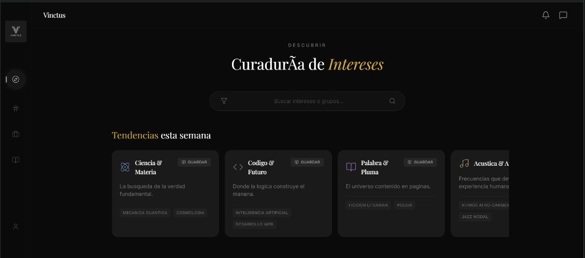
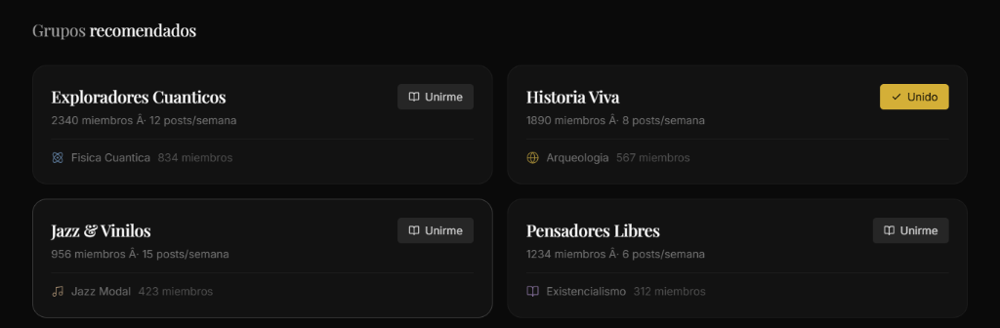
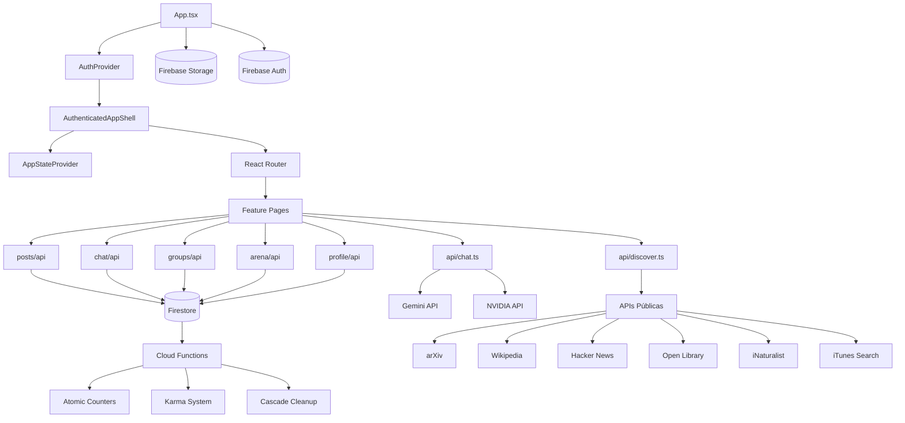
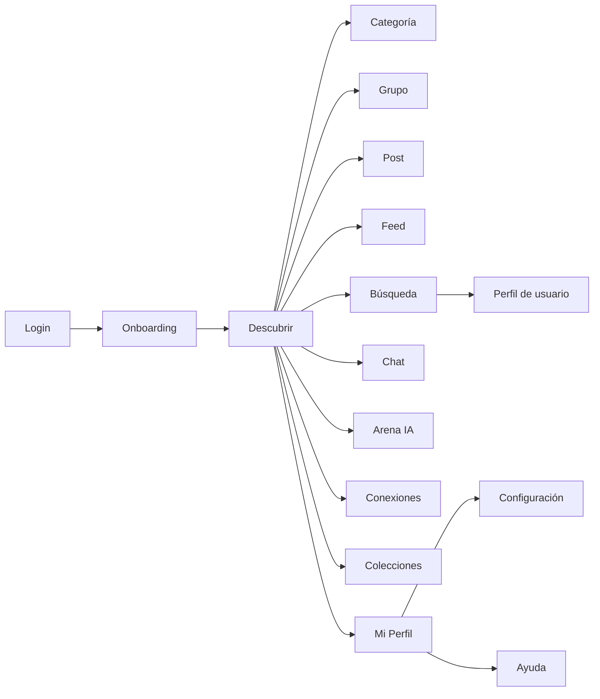

<p align="center">
  
</p>

# Vinctus

Red social basada en intereses. Conecta con comunidades de ciencia, música, historia y más.

## Estado del proyecto

Aplicación en producción desplegada en **Vercel** con backend completo en **Firebase** (Auth, Firestore, Storage, Cloud Functions). Incluye autenticación real, datos persistentes, mensajería en tiempo real y capacidades de IA.

## Clientes y entornos

Vinctus tiene dos clientes que leen y escriben los mismos datos de Firebase:

- **Web** (React + Vite) en `src/`, con endpoints serverless de Vercel en `api/`.
- **App nativa de iPhone** (SwiftUI) en `ios-native/VinctusNative/` ([arquitectura](ios-native/VinctusNative/ARCHITECTURE.md)). Se compila y se sube a TestFlight desde GitHub Actions, sin Mac propia ([docs/testflight-sin-mac.md](docs/testflight-sin-mac.md)).

| Entorno               | Web                          | Proyecto Firebase               | Publicación                                                                                                                                                                                                                                                                                                   |
| --------------------- | ---------------------------- | ------------------------------- | ------------------------------------------------------------------------------------------------------------------------------------------------------------------------------------------------------------------------------------------------------------------------------------------------------------- |
| Producción            | `vinctus.vercel.app`         | `vinctus-daf32`                 | Vercel despliega `main` automáticamente. Reglas, índices y Functions se despliegan a mano con `firebase deploy --project vinctus-daf32`.                                                                                                                                                                      |
| Staging               | `vinctus-staging.vercel.app` | `vinctus-staging`               | Proyecto de Vercel aparte (`vinctus-staging`). Ramas `testflight/vinctus-staging` y `deploy/vinctus-staging`, con los rewrites de `/__/auth/*` y `/__/firebase/*` apuntando a `vinctus-staging`. Vercel no despliega `testflight/vinctus-staging` automáticamente (`git.deploymentEnabled` en `vercel.json`). |
| CI y desarrollo local | `localhost:5173`             | `vinctus-dev` (solo emuladores) | —                                                                                                                                                                                                                                                                                                             |

El repositorio no tiene `.firebaserc`, así que todo `firebase deploy` debe indicar `--project`. El orden seguro de despliegue (índices → Functions → clientes → reglas) está en [docs/plan-despliegue-coordinado.md](docs/plan-despliegue-coordinado.md).

## Características

- **Descubrimiento** — Exploración por categorías (ciencia, música, historia, tecnología, etc.) con contenido de APIs públicas y publicaciones de la comunidad.
- **Feed y publicaciones** — Creación de posts con texto e imágenes, likes, comentarios, guardado y compartir.
- **Historias** — Historias efímeras (24h) visibles solo para amigos.
- **Grupos** — Creación y gestión de grupos con roles (admin, moderador, miembro), edición y chat grupal.
- **Chat en tiempo real** — Conversaciones privadas y grupales con actualizaciones en tiempo real vía Firestore.
- **Perfil y red social** — Perfiles editables, seguidores, seguidos, amigos con solicitudes de amistad, cuentas privadas.
- **Arena IA** — Debates generados por inteligencia artificial (Gemini / NVIDIA) entre dos personajes sobre temas personalizados.
- **Chat IA** — Conversación directa con modelos de IA (Gemini, OpenAI y NVIDIA Llama 3.3).
- **Búsqueda de usuarios** — Búsqueda global de usuarios registrados con vista de perfil.
- **Notificaciones** — Feed de actividad (likes, comentarios, solicitudes de amistad).
- **Colecciones** — Biblioteca personal para guardar enlaces, notas y archivos organizados en carpetas.
- **Portafolio** — Sección de contribuciones (proyectos, papers, certificados).
- **Eventos** — Creación y asistencia a eventos con contadores atómicos.
- **Bloqueo y reportes** — Sistema de bloqueo de usuarios y reportes de abuso.
- **Configuración** — Tema claro/oscuro, privacidad, notificaciones, cambio de contraseña.
- **Centro de ayuda** — Envío de tickets de soporte y solicitudes de features.
- **PWA** — Instalable como aplicación móvil con Service Worker.
- **Diseño responsive** — Desktop + mobile con navegación adaptativa.
- **Onboarding** — Tutorial guiado para nuevos usuarios.

## Capturas

**Descubrir - Intereses**



**Descubrir - Grupos recomendados**



**Descubrir - Publicaciones**


## Arquitectura



**Flujo de usuario**



## Requisitos

- Node.js 22 (`.nvmrc`; `engines` en `package.json` exige `22.x`)
- npm
- Java 21 para los emuladores de Firebase (la versión que usa CI)

## Instalación y uso

```bash
npm install
npm run dev
```

Abre `http://localhost:5173`.

Para previsualizar el build:

```bash
npm run build
npm run preview
```

## Desarrollo local con emuladores

```bash
npm run dev:local
```

Inicia Firebase Emulator Suite (Auth/Firestore/Storage/Functions), aplica el seed y levanta Vite en `http://localhost:5173`.
Emulator UI: `http://localhost:4000`.

Usuarios seed (email / password):

- `alice@vinctus.local` / `password123`
- `bob@vinctus.local` / `password123`
- `carla@vinctus.local` / `password123`

## Scripts útiles

| Script                         | Descripción                                                                                   |
| ------------------------------ | --------------------------------------------------------------------------------------------- |
| `npm run dev`                  | Desarrollo con Vite                                                                           |
| `npm run dev:local`            | Emuladores + seed + Vite                                                                      |
| `npm run build`                | Build de producción (typecheck + vite build)                                                  |
| `npm run preview`              | Preview del build                                                                             |
| `npm run lint`                 | ESLint                                                                                        |
| `npm run typecheck`            | TypeScript sin emitir                                                                         |
| `npm run check:cycles`         | Detecta ciclos de dependencias en `src`                                                       |
| `npm run check:stubs`          | Valida fecha de caducidad + ticket en stubs                                                   |
| `npm run check:raw-onsnapshot` | Detecta usos directos de `onSnapshot`                                                         |
| `npm run guardrails`           | lint + ciclos + stubs + onSnapshot                                                            |
| `npm run contract:generate`    | Regenera los archivos derivados de `shared/firestore-contract.json` (web, Functions, iOS)     |
| `npm run contract:check`       | Falla si esos archivos generados están desactualizados (se ejecuta en CI)                     |
| `npm run test`                 | Vitest en modo watch                                                                          |
| `npm run test:run`             | Vitest en modo CI                                                                             |
| `npm run test:api`             | Tests de `api/` y tests unitarios de `functions/src`                                          |
| `npm run test:coverage`        | Tests con reporte de cobertura                                                                |
| `npm run test:rules`           | Tests de reglas de Firestore y Storage (levanta los emuladores)                               |
| `npm run test:post-counts`     | Integración de contadores y limpiezas de Cloud Functions (emuladores con Functions)           |
| `npm run test:post-reads`      | Integración de `readPosts` / `readPostMedia` y limpieza de subidas (emuladores con Functions) |
| `npm run test:e2e`             | Playwright E2E                                                                                |
| `npm run test:e2e:smoke`       | Playwright smoke tests                                                                        |
| `npm run test:e2e:local-ci`    | E2E como en CI: emuladores + seed + Playwright                                                |
| `npm run lhci`                 | Lighthouse CI (build + collect + assert)                                                      |
| `npm run validate`             | Pipeline completo: typecheck + lint + coverage + api tests + build                            |
| `npm run ci`                   | Alias de validate                                                                             |
| `npm run emulators`            | Firebase emuladores                                                                           |
| `npm run seed`                 | Seed de datos en emuladores                                                                   |
| `npm run functions:install`    | Instala deps de Cloud Functions                                                               |
| `npm run functions:build`      | Build de Cloud Functions                                                                      |

## Testing

- **Unit tests**: Vitest (`src/**/*.test.ts(x)`) con meta de cobertura ≥ 85% (statements/functions/lines)
- **API y Functions**: `npm run test:api` — `api/**/*.test.ts` y tests unitarios de `functions/src/**/*.test.ts`
- **Reglas**: `npm run test:rules` — casos de `src/tests/firestore-rules/` y `src/tests/storage-rules/` contra emuladores Firebase
- **Integración de Cloud Functions**: `npm run test:post-counts` y `npm run test:post-reads` — `scripts/*.integration.test.mjs` contra emuladores con Functions
- **E2E**: Playwright — `e2e/*.spec.ts`, una spec por módulo (perfiles, grupos, historias, publicaciones, chat, IA, cuenta…) más `smoke` y `critical-flows`
- **Lighthouse CI**: Home/Feed/Chat/Groups con umbral ≥ 0.90
- **iOS**: `Tests/` (sin Firebase) e `IntegrationTests/` (contra emuladores); ver [ios-native/VinctusNative/ARCHITECTURE.md](ios-native/VinctusNative/ARCHITECTURE.md)

En GitHub Actions, `.github/workflows/ci.yml` ejecuta todo lo web en cada PR y en cada push a `main`. `.github/workflows/ios-native.yml` compila y prueba la app nativa cuando cambian la app, las reglas, `firebase.json`, las Functions o el contrato compartido.

## Variables de entorno

Copia `.env.example` a `.env.local` y completa lo necesario:

### Firebase (requerido)

- `VITE_FIREBASE_API_KEY` — API key del proyecto Firebase
- `VITE_FIREBASE_AUTH_DOMAIN` — Dominio de autenticación
- `VITE_FIREBASE_PROJECT_ID` — ID del proyecto
- `VITE_FIREBASE_STORAGE_BUCKET` — Bucket de Storage
- `VITE_FIREBASE_MESSAGING_SENDER_ID` — ID del sender
- `VITE_FIREBASE_APP_ID` — ID de la aplicación

### Emuladores (opcional)

- `VITE_USE_FIREBASE_EMULATOR` — `true` para usar emuladores en local
- `VITE_FIREBASE_EMULATOR_HOST` — Host para emuladores (default `127.0.0.1`)

### App Check y acceso (opcional)

- `VITE_ENABLE_FIREBASE_APP_CHECK` — `true` para activar App Check en web (desactivado por defecto)
- `VITE_FIREBASE_APP_CHECK_SITE_KEY` — Clave de sitio de reCAPTCHA Enterprise (tipo puntuación) registrada en App Check; App Check ya no admite registros nuevos con reCAPTCHA v3
- `VITE_FIREBASE_APP_CHECK_DEBUG_TOKEN` — Token de depuración para local/staging; nunca en producción
- `VITE_FIREBASE_APP_CHECK_TOKEN_AUTO_REFRESH` — `true` por defecto
- `VITE_ENABLE_APPLE_SIGN_IN` — Muestra el botón de Sign in with Apple

### Discover APIs (opcional)

- `VITE_CORS_PROXY` — Proxy CORS de fallback para desarrollo local cuando `/api/discover` no está disponible
- `VITE_MUSIC_COUNTRY` — País para fallback directo de música en cliente (default `US`)
- `DISCOVER_MUSIC_COUNTRY` — País para proveedor de música del endpoint server-side `api/discover` (default `US`)

### Server-side AI (variables de servidor, no expuestas al cliente)

- `OPENAI_API_KEY` — Clave de un proyecto de la organización de OpenAI que recibió los créditos. Configurar solo en el servidor (por ejemplo, en variables de entorno de Vercel), nunca con prefijo `VITE_` ni en el repositorio.
- `OPENAI_MODEL` — Modelo de OpenAI para el chat (default `gpt-6.1-terra`, razonamiento alto; debe ser compatible con Responses API y sus herramientas).
- En Chat IA, cada usuario puede seleccionar OpenAI para esa sesión; el historial se envía al proveedor seleccionado. Si falla, se intentan los proveedores alternativos configurados y se indica cuál respondió. Arena mantiene su configuración actual.
- En el chat de OpenAI se puede adjuntar una imagen PNG/JPEG/WebP de hasta 2 MB o solicitar una imagen nueva. Las imágenes adjuntas solo se envían en ese turno, no se conservan en el historial; no se utiliza un proveedor alternativo para solicitudes con imágenes. La voz actual usa las funciones del navegador.
- La generación de imágenes requiere Firebase Admin (`FIREBASE_SERVICE_ACCOUNT`) para reservar cuotas atómicas: máximo 5 intentos por usuario y 50 para toda la aplicación por día UTC, incluidos intentos fallidos. Si no se puede consultar la cuota, no se envía la solicitud. Estos límites son independientes de los límites y créditos de OpenAI; supervisar ambos antes de publicar.
- Los límites de solicitudes de Vinctus no son un límite monetario: revisa el consumo, los créditos y la recarga automática en la plataforma de OpenAI antes de habilitar el servicio para usuarios.
- `GEMINI_API_KEY` — API key de Google Gemini
- `GEMINI_TIMEOUT_MS` — Timeout para llamadas a Gemini (default 12000)
- `NVIDIA_API_KEY` — API key de NVIDIA
- `NVIDIA_BASE_URL` — URL base de la API NVIDIA
- `NVIDIA_MODEL` — Modelo a usar (default `meta/llama-3.3-70b-instruct`)
- `GEMINI_MODELS` — Lista de modelos Gemini separados por coma (default `gemini-3.8-flash,gemini-2.5-flash,gemini-flash-lite-latest,gemini-flash-latest`)
- `NVIDIA_MODEL` y `GEMINI_MODELS` se prueban primero; los modelos default quedan siempre como respaldo, así un modelo retirado en estas variables no deja el chat sin IA.
- `CHAT_USER_MINUTE_LIMIT` / `CHAT_USER_DAY_LIMIT` — Rate limits por usuario
- `CHAT_IP_MINUTE_LIMIT` / `CHAT_IP_DAY_LIMIT` — Rate limits por IP
- `FIREBASE_SERVICE_ACCOUNT` — JSON de la cuenta de servicio de Firebase Admin (en una línea). `api/chat.ts` lo usa para verificar el consentimiento de IA y para acciones que escriben datos (crear grupo). Si falta, el consentimiento se verifica con Firestore REST y el token del usuario, pero esas acciones fallan.

### YouTube (variables de servidor, opcional)

- `YOUTUBE_API_KEY` — Usada por `api/youtube.ts` (metadatos de vídeos), `api/youtube-search.ts` (vídeos en Descubrir) y `api/youtube-shorts.ts` (Shorts en Historias)
- Límites, caché y región de cada endpoint: `YOUTUBE_*_IP_MINUTE_LIMIT`, `YOUTUBE_*_IP_DAY_LIMIT`, `YOUTUBE_*_CACHE_TTL_SECONDS`, `YOUTUBE_SEARCH_REGION_CODE` y `YOUTUBE_SHORTS_REGION_CODE`

La lista completa, con las URLs legales (`VITE_PRIVACY_POLICY_URL`…) y la cuenta demo de App Review (`REVIEW_*`), está en `.env.example`.

## APIs externas

Se consumen APIs públicas (sin API key) para contenido en vivo:

- **arXiv** — Ciencia
- **Wikipedia** — Historia
- **Hacker News** — Tecnología
- **Open Library** — Literatura
- **iNaturalist** — Naturaleza
- **iTunes Search API** — Música

Estas fuentes se consumen por `api/discover` (server-side proxy con caché) para evitar CORS en el cliente y reducir latencia/costos.
En local, existe fallback directo en cliente y proxy CORS configurable.

Además, con `YOUTUBE_API_KEY`, los endpoints `api/youtube*.ts` consultan la **YouTube Data API** para vídeos de publicaciones, Descubrir e Historias.

## Estructura del proyecto

```
vinctus/
├── src/
│   ├── app/                    # Capa de aplicación
│   │   ├── providers/          # AuthContext, AppState
│   │   ├── routes/             # AuthenticatedAppShell (router), AppLayout (rutas y navegación), Header
│   │   └── services/           # Servicios compartidos de aplicación
│   ├── features/               # Módulos de dominio (Feature-Sliced)
│   │   ├── ai/                 # Chat IA
│   │   ├── arena/              # Arena de debates IA
│   │   ├── auth/               # Login, registro, onboarding
│   │   ├── chat/               # Mensajería en tiempo real
│   │   ├── collaborations/     # Colaboraciones
│   │   ├── collections/        # Colecciones / Biblioteca
│   │   ├── discover/           # Descubrimiento, categorías y búsqueda de usuarios
│   │   ├── events/             # Eventos
│   │   ├── groups/             # Grupos
│   │   ├── help/               # Centro de ayuda
│   │   ├── legal/              # Privacidad, términos y normas de la comunidad
│   │   ├── moderation/         # Cola de moderación
│   │   ├── notifications/      # Notificaciones
│   │   ├── posts/              # Publicaciones, feed, historias
│   │   ├── profile/            # Perfil, seguidores, amigos
│   │   ├── projects/           # Conexiones / Portafolio
│   │   └── settings/           # Configuración, privacidad y eliminación de cuenta
│   ├── shared/                 # Código compartido (no importa features ni app)
│   │   ├── constants/          # Constantes globales
│   │   ├── hooks/              # Hooks reutilizables (useApiContent)
│   │   ├── lib/                # Firebase, acceso a Firestore (lib/firestore), errores, validación, storage
│   │   ├── types/              # Tipos compartidos
│   │   └── ui/                 # Componentes UI (Toast, ErrorBoundary, Skeleton)
│   ├── tests/                  # Casos de reglas de Firestore y Storage (npm run test:rules)
│   ├── context/                # Contextos legacy
│   ├── App.tsx                 # Componente raíz (auth, onboarding)
│   ├── main.tsx                # Punto de entrada
│   └── index.css               # Estilos globales
├── api/                        # Serverless functions (Vercel)
│   ├── chat.ts                 # Chat IA (Gemini, OpenAI, NVIDIA) y acciones con Firebase Admin
│   ├── discover.ts             # Proxy/caché de APIs públicas para Discover
│   ├── youtube*.ts             # Metadatos, búsqueda y Shorts de YouTube
│   └── lib/                    # Firebase Admin, rate limit, contrato y acciones de IA
├── functions/                  # Cloud Functions (Firebase)
│   └── src/index.ts            # Punto de entrada: triggers, callables y endpoints HTTP
├── shared/
│   └── firestore-contract.json # Contrato de colecciones, límites y rutas de Storage (web, iOS y Functions)
├── ios-native/VinctusNative/   # App nativa de iPhone (SwiftUI + XcodeGen)
├── e2e/                        # Tests E2E (Playwright)
├── scripts/                    # Scripts de CI, seed, métricas, Lighthouse, migraciones y publicación iOS
├── docs/                       # Documentación y screenshots
├── firestore.rules             # Reglas de seguridad de Firestore
├── storage.rules               # Reglas de seguridad de Storage
├── firestore.indexes.json      # Índices compuestos de Firestore
├── firebase.json               # Configuración de Firebase
├── vercel.json                 # Configuración de Vercel (headers de seguridad, SPA rewrites)
├── eslint.config.js            # ESLint con boundary enforcement entre capas
├── tailwind.config.js          # Tailwind CSS
├── vite.config.ts              # Vite + PWA
├── playwright.config.ts        # Playwright E2E
├── vitest.config.ts            # Vitest unit tests
└── tsconfig.json               # TypeScript strict mode
```

Cada módulo en `features/` sigue la convención:

```
features/<dominio>/
├── api/                # queries.ts, mutations.ts, types.ts (+ tests)
├── components/         # Componentes del dominio
└── pages/              # Páginas del dominio
```

## Cloud Functions

Punto de entrada: `functions/src/index.ts` (Node 22).

Triggers de Firestore y Storage:

- **Contadores atómicos** — `memberCount`, `likesCount`, `attendeesCount` con deduplicación
- **Sistema de karma** — Reputación calculada por likes recibidos
- **Contadores de follow** — `followersCount`, `followingCount`
- **Solicitudes de seguimiento** — Al aceptar una solicitud a una cuenta privada, `onFollowRequestUpdated` crea `followers` y `following` en una transacción (las reglas no dejan que el cliente los escriba)
- **Cascade cleanup** — Limpieza de subcolecciones al eliminar grupos, eventos, historias, colecciones o usuarios
- **Friend index** — Índice de amigos al aceptar solicitudes
- **Group conversations** — Auto-creación de conversaciones grupales
- **Moderación** — Revisión automática de publicaciones, comentarios, perfiles, grupos y mensajes, y cola de reportes (`onReportCreatedQueue`)

Funciones que llaman los clientes directamente:

- `readPosts` (callable) y `readPostMedia` (HTTP) — Lectura de publicaciones y adjuntos respetando la privacidad
- `createDebate`, `getArenaUsage`, `getArenaPersonas` — Arena IA
- `requestAccountDeletion`, `getAccountDeletionStatus`, `deleteUserAccount`, `revokeUserSessions` — Cuenta y seguridad
- `moderationTakeAction` — Acciones de moderación

## Calidad y CI

- **TypeScript strict** — `strictNullChecks`, `noImplicitAny`, `noUnusedLocals`
- **ESLint boundary enforcement** — `shared` no importa `features`/`app`, `features` no importa `app`
- **Contrato compartido** — `npm run contract:check` falla en CI si los archivos generados desde `shared/firestore-contract.json` no están al día
- **Validación con Zod** — Schemas de validación en todas las API de dominio
- **Clase AppError** — Manejo de errores con mapeo Firebase → códigos de app
- **Retry + Timeout** — Helpers de resiliencia para operaciones de red
- **Lighthouse CI** — Gates de performance ≥ 0.90 en páginas clave
- **Git hooks** — `lint-staged` + `prettier` en pre-commit
- **Cobertura** — Meta ≥ 85% en statements/functions/lines

## Headers de seguridad (Vercel)

Definidos en `vercel.json`:

- **Todas las rutas**: `X-Content-Type-Options: nosniff`, `Referrer-Policy: strict-origin-when-cross-origin`, `Strict-Transport-Security: max-age=31536000; includeSubDomains; preload` y `Permissions-Policy` (cámara, geolocalización, pagos, USB y `browsing-topics` desactivados; micrófono solo para el propio sitio, por las notas de voz).
- **SPA** (todo salvo `/__/auth/`, `/__/firebase/` y `/api/`): `X-Frame-Options: SAMEORIGIN` y `Content-Security-Policy` con la lista de orígenes permitidos (Firebase, Google, Apple, reCAPTCHA, YouTube y las APIs de Descubrir). El iframe de Firebase Auth en `/__/auth/iframe` se sirve desde el mismo dominio.
- **`/api/*`**: `X-Frame-Options: DENY`, `Referrer-Policy: no-referrer` y `Content-Security-Policy: default-src 'none'; frame-ancestors 'none'`. `/api/chat` además envía `Cache-Control: private, no-store, max-age=0`.

## Stack tecnológico

- **Frontend**: React 19 + Vite 6 + TypeScript 5
- **Estilos**: Tailwind CSS 3 + tailwindcss-animate
- **Routing**: React Router DOM 7
- **Backend**: Firebase (Auth, Firestore, Storage, Cloud Functions)
- **IA**: Google Gemini, OpenAI (solo Chat IA) y NVIDIA (`meta/llama-3.3-70b-instruct` por defecto); la Arena usa Gemini y NVIDIA
- **Hosting**: Vercel (SPA + serverless functions)
- **App iOS**: SwiftUI + Firebase iOS SDK, proyecto generado con XcodeGen
- **Iconos**: Lucide React
- **Validación**: Zod 4
- **PWA**: vite-plugin-pwa
- **Testing**: Vitest + Playwright + Lighthouse CI + XCTest (iOS)
- **Tipografía**: Inter + Playfair Display (Google Fonts)

## Licencia

MIT
